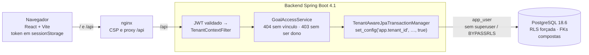

# Vesta

POC de um SaaS financeiro multitenant para famílias: objetivos financeiros individuais e
compartilhados, contribuições por membro e acompanhamento de progresso, com isolamento entre
famílias (tenants) e controle de acesso por objetivo dentro de cada família.

A POC também documenta, com evidências, como o Claude Code apoiou análise, arquitetura,
implementação, testes, revisão e documentação. Veja o [AI Development Report](docs/ia/ai-development-report.md).

> **Situação (P-010):** POC concluída. Backend com Row-Level Security forçada, login JWT,
> autorização por objetivo, contribuições e estornos imutáveis e progresso financeiro; frontend React
> de demonstração; duas famílias de demonstração; 160 testes no backend e 28 no frontend, rodados
> também pela CI. ADR-0001 aceito.

## Arquitetura



O isolamento entre famílias tem várias camadas independentes ([ADR-0001](docs/adr/0001-estrategia-multitenant.md)):

1. **Token:** a família vem só do JWT assinado no login ([ADR-0002](docs/adr/0002-autenticacao-jwt.md));
   valores enviados pelo cliente são ignorados.
2. **Persistência:** o Hibernate (`@TenantId`) filtra e preenche `family_id` nas entidades.
3. **Banco:** cada transação define o tenant com `set_config(..., true)`, e a RLS forçada restringe
   todas as tabelas, inclusive em SQL nativo; a aplicação usa uma role sem superuser nem BYPASSRLS.
4. **Integridade:** chaves estrangeiras compostas com `family_id` impedem referências entre famílias;
   o login usa uma única função `SECURITY DEFINER`, e a aplicação não lê hashes de senha.
5. **Por objetivo:** só quem tem vínculo vê o objetivo (404 para os demais); ações de dono dão 403 a membros.
6. **Testes:** cada garantia tem teste automatizado e teste de mutação registrado.

## Como executar

Pré-requisitos e passo a passo em [docs/setup-local.md](docs/setup-local.md).

```bash
cp .env.example .env
docker compose up -d --build        # PostgreSQL + backend (perfil local, dados demo) + frontend
# Abra http://localhost:3000 e entre com carlos@silva.demo / vesta-demo
```

Usuários de demonstração: Carlos, Ana, Pedro, Júlia e Lucas (Família Silva) e Marcos e Beatriz
(Família Souza), todos com a senha `vesta-demo`.

## Demonstração

O [roteiro de demonstração](docs/demonstracao.md) cobre o fluxo principal na interface e os cenários
negativos N-1 a N-9, cada um com o lugar onde é demonstrado (tela, Bruno ou o script SQL
`infra/demo/n3-rls-sem-where.sql`) e o teste automatizado que o cobre.

## Testes e CI

```bash
cd backend && ./mvnw verify                                        # 160 testes (JDK 21 + Docker)
cd frontend && npm ci && npm run lint && npm test && npm run build # 28 testes (Node 22)
cd bruno && npx -y @usebruno/cli@4.3.0 run --env local             # 38 requisições contra o Compose
```

A CI (`.github/workflows/ci.yml`) roda o backend (com Testcontainers) e o frontend a cada push e PR para a `main`.

## API

| Método e rota | Acesso | Descrição |
|---|---|---|
| `POST /api/auth/login` | público | `{email, password}` → `{accessToken, tokenType, expiresIn}` |
| `GET /api/me` | token | Usuário logado e sua família |
| `GET /api/goals?status=` | token | Objetivos em que o usuário tem vínculo, com progresso; sem `status`, exclui arquivados |
| `POST /api/goals` | token | Cria objetivo (o criador vira dono); `members` opcional |
| `GET /api/goals/{id}` | vinculados | Detalhe, membros, progresso e total por membro |
| `PATCH /api/goals/{id}` | dono, só ATIVO | Título, descrição, valor-alvo, data-limite |
| `POST /api/goals/{id}/complete` · `reopen` · `archive` · `unarchive` | dono | Transições de status (D-14) |
| `DELETE /api/goals/{id}` | dono | Só objetivos sem contribuições |
| `POST /api/goals/{id}/members` | dono | Adiciona membro da família (`userId`, `role`, `contributes`) |
| `PATCH /api/goals/{id}/members/{userId}` | dono | Papel e/ou participação financeira |
| `DELETE /api/goals/{id}/members/{userId}` | dono, ou o próprio membro (sair) | O último dono não sai |
| `GET /api/goals/{id}/contributions?page=&size=` | vinculados | Contribuições paginadas, mais recentes primeiro, estornadas sinalizadas |
| `POST /api/goals/{id}/contributions` | participante (a própria) ou dono (para participante) | `{amount, contributedOn?, note?, contributorId?}`; só objetivos ativos |
| `POST /api/goals/{id}/contributions/{contributionId}/reversal` | o contribuinte ou o dono | `{reason}`; só objetivos ativos; uma vez por contribuição |
| `GET /api/family/members` | token | Membros da família do usuário |
| `GET /actuator/health` | público | Saúde da aplicação |

Erros (`application/problem+json`, em português): 401 sem token válido; 404 para recurso inexistente,
de outra família ou sem vínculo; 403 para quem vê mas não pode; 409 para conflito de estado; 422
para dados inválidos.

## Stack

| Componente | Versão |
|---|---|
| Java | 21 (Temurin) |
| Spring Boot | 4.1.1 (Spring Framework 7, Hibernate 7) |
| Maven | 3.10.0, via Maven Wrapper |
| PostgreSQL | 18.6 (Docker) |
| Flyway | migrations do esquema e seeds de demonstração |
| Testcontainers | testes de integração com PostgreSQL real |
| React 19 + Vite 8 + TypeScript | frontend de demonstração (`react-router`, CSS próprio, Vitest) |
| nginx 1.28 | serve o frontend e faz proxy de `/api` no Compose |
| Docker Compose | ambiente local |
| Bruno | coleção de requisições e cenários |
| GitHub Actions | CI do backend e do frontend |

## Estrutura

```
backend/                 API Spring Boot (pacote com.vesta)
  src/main/java/com/vesta/auth/          login, JWT, configuração de segurança
  src/main/java/com/vesta/tenant/        TenantContext, filtro do token, vínculo do tenant à transação
  src/main/java/com/vesta/goal/          objetivos, membros, autorização por objetivo, progresso
  src/main/java/com/vesta/contribution/  contribuições e estornos (imutáveis)
  src/main/java/com/vesta/user/, family/ usuários, família e /api/me
  src/main/resources/db/migration/       migrations Flyway (esquema, RLS, privilégios, lookup de login)
  src/main/resources/db/seed/            famílias de demonstração (perfil local)
frontend/                app React (src/api, src/auth, src/pages, src/components), nginx.conf, Dockerfile
infra/postgres/init/     criação das roles app_owner, app_user e app_auth
infra/demo/              script de demonstração da RLS (N-3)
bruno/                   coleção Bruno (auth, goals, contributions)
docs/                    requisitos, domínio, decisões, ADRs, setup, demonstração e registros de IA
.github/workflows/       CI
docker-compose.yml       PostgreSQL + backend + frontend
```

## Limitações conhecidas

- Sem parcelas com vencimento, recorrência, cadastro/convite de usuários, multimoeda ou troca de família
  (fora do escopo por decisão: D-04, D-11, D-12, DT-04).
- Token sem refresh e revogação só por expiração (60 minutos).
- Concorrência real (por exemplo, dois donos saindo ao mesmo tempo) protegida por locks, mas sem teste dedicado.
- Gestão de membros depois da criação do objetivo só pela API/Bruno, sem tela.

## Documentação

| Documento | Conteúdo |
|---|---|
| [Setup local](docs/setup-local.md) | Pré-requisitos, execução, testes e solução de problemas |
| [Roteiro de demonstração](docs/demonstracao.md) | Fluxo principal e cenários N-1..N-9 com as evidências |
| [Requisitos](docs/requisitos.md) | Requisitos, critérios de aceitação, matriz de permissões e situação final |
| [Modelo de domínio](docs/modelo-de-dominio.md) | Glossário PT → código, entidades, invariantes, ciclo de vida e cálculos |
| [Decisões de negócio](docs/decisoes-de-negocio.md) | Decisões D-xx, convenções e escolhas técnicas |
| [ADR-0001 — Estratégia multitenant](docs/adr/0001-estrategia-multitenant.md) | Isolamento, alternativas, riscos e evidências finais (Aceito) |
| [ADR-0002 — Autenticação com JWT](docs/adr/0002-autenticacao-jwt.md) | HS256, validade, claims, alternativas e consequências |
| [Histórico de prompts](docs/ia/historico-de-prompts.md) | Prompts usados no desenvolvimento |
| [Decisões influenciadas pela IA](docs/ia/decisoes-influenciadas-pela-ia.md) | Sugestões da IA aceitas e rejeitadas |
| [Sugestões incorretas da IA](docs/ia/sugestoes-incorretas.md) | Erros da IA com evidência e aprendizado |
| [AI Development Report](docs/ia/ai-development-report.md) | Relatório cumulativo e consolidação final do uso de IA |
| [CLAUDE.md](CLAUDE.md) | Instruções persistentes para o Claude Code |
