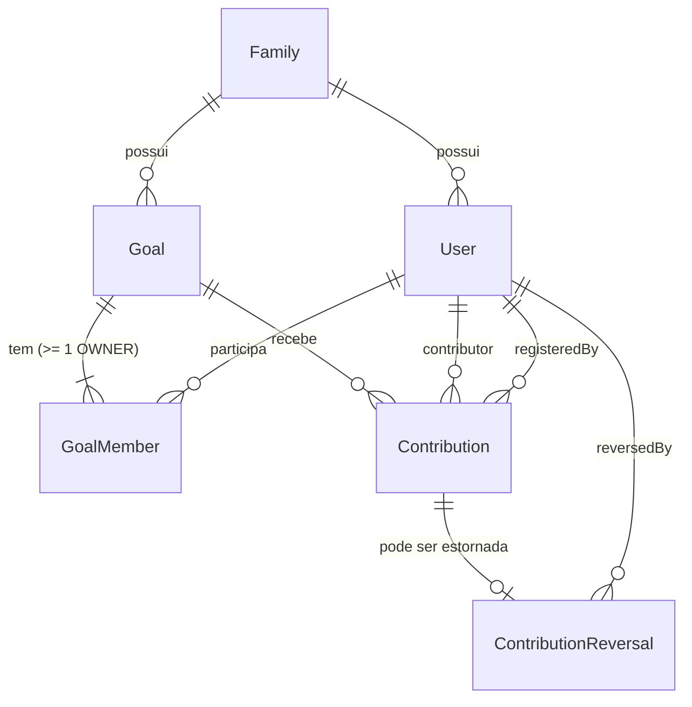
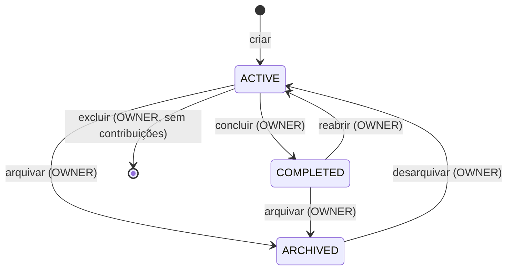

# Modelo de domínio

> **Status:** versão conceitual (P-001, 2026-10-21). O esquema físico correspondente foi criado em
> P-003 nas migrations `backend/src/main/resources/db/migration/V1..V3`, respeitando as invariantes
> abaixo e o [ADR-0001](adr/0001-estrategia-multitenant.md). Entidade JPA mapeada até agora: `Goal`.

## 1. Glossário

Convenção de idioma: interface e documentação em português; identificadores e comentários no
código em inglês. Esta tabela é a referência para nomear entidades, campos e enums.

| Termo (PT) | Identificador no código (EN) | Definição |
|---|---|---|
| Família | `Family` | Tenant. Agrupa usuários e todos os dados de negócio. |
| Membro da família / usuário | `User` | Pessoa com login. Pertence a exatamente uma família. |
| Objetivo / meta | `Goal` | Meta financeira com valor-alvo. |
| Membro do objetivo | `GoalMember` | Vínculo entre um usuário e um objetivo; define acesso e participação. |
| Papel no objetivo | `GoalRole` | `OWNER` (DONO) ou `MEMBER` (MEMBRO). |
| Contribui (participação financeira) | `contributes` | Indica se o membro pode ser contribuinte. |
| Contribuição | `Contribution` | Valor efetivamente guardado ou pago, imutável. |
| Estorno | `ContributionReversal` | Anula uma contribuição, com autor, data e motivo. |
| Contribuinte | `contributor` | Usuário a quem a contribuição é atribuída. |
| Registrado por | `registeredBy` | Usuário que lançou a contribuição. |
| Status do objetivo | `GoalStatus` | `ACTIVE` (ATIVO), `COMPLETED` (CONCLUÍDO), `ARCHIVED` (ARQUIVADO). |
| Valor-alvo | `targetAmount` | Valor que se pretende alcançar. |
| Data-limite | `dueDate` | Opcional e apenas informativa. |
| Acumulado | `accumulatedAmount` | Soma das contribuições não estornadas. |
| Restante | `remainingAmount` | `max(targetAmount − accumulatedAmount, 0)` |
| Excedente | `surplusAmount` | `max(accumulatedAmount − targetAmount, 0)` |
| Percentual | `progressPercentage` | `accumulatedAmount ÷ targetAmount × 100` |
| Meta atingida | `targetReached` | `accumulatedAmount ≥ targetAmount` |
| Identificador do tenant | `familyId` / `family_id` | Chave do tenant presente em toda entidade de negócio. |

## 2. Entidades



### Family

| Atributo | Descrição |
|---|---|
| `id` | Identificador. |
| `name` | Nome da família. |

### User

| Atributo | Descrição |
|---|---|
| `id` | Identificador; usado como `sub` no JWT. |
| `familyId` | Família à qual pertence (exatamente uma). |
| `email` | Login; único em todo o sistema. |
| `passwordHash` | Hash da senha (nunca texto puro). |
| `displayName` | Nome exibido. |

### Goal

| Atributo | Descrição |
|---|---|
| `id`, `familyId` | Identificador e tenant. |
| `title` | Obrigatório. |
| `description` | Opcional. |
| `targetAmount` | BRL, > 0, duas casas decimais. |
| `currency` | Fixo `BRL` na POC. |
| `dueDate` | Opcional, informativa. |
| `status` | `ACTIVE`, `COMPLETED`, `ARCHIVED`. |
| `createdBy`, `createdAt` | Criador e data de criação. |
| `completedAt`, `archivedAt` | Datas das transições (quando aplicável). |

### GoalMember

| Atributo | Descrição |
|---|---|
| `familyId`, `goalId`, `userId` | Vínculo; único por (`goalId`, `userId`). |
| `role` | `OWNER` ou `MEMBER` — define o **acesso**. |
| `contributes` | Define a **participação financeira**; padrão `true`. |
| `addedBy`, `addedAt` | Rastreabilidade do vínculo. |

### Contribution

| Atributo | Descrição |
|---|---|
| `id`, `familyId`, `goalId` | Identificador, tenant e objetivo. |
| `contributorId` | Usuário a quem o valor é atribuído. |
| `registeredById` | Usuário que lançou o registro. |
| `amount` | BRL, > 0, duas casas decimais. |
| `contributedOn` | Data informada pelo usuário (não futura). |
| `note` | Observação opcional. |
| `createdAt` | Momento do registro no servidor. |

### ContributionReversal

| Atributo | Descrição |
|---|---|
| `id`, `familyId`, `contributionId` | No máximo um estorno por contribuição (D-13). |
| `reversedById` | Autor do estorno. |
| `reason` | Motivo obrigatório. |
| `reversedAt` | Momento do estorno. |

O estorno é um registro separado; a linha da contribuição original nunca é alterada.

## 3. Invariantes

**Tenant**

- INV-01 Toda entidade de negócio carrega `familyId`, e todas as referências entre entidades
  apontam para registros da **mesma** família (garantido por chaves compostas com `family_id`).
- INV-02 O `familyId` de um registro é sempre o tenant do usuário autenticado; nunca vem do cliente.

**Acesso e participação**

- INV-03 Um usuário só vê um objetivo se existir um `GoalMember` dele para esse objetivo.
- INV-04 Todo objetivo tem pelo menos um `GoalMember` com `role = OWNER`.
- INV-05 Só usuários da mesma família do objetivo podem ser `GoalMember`.
- INV-06 Ao criar um objetivo, o criador vira `OWNER` com `contributes = true`.

**Contribuições**

- INV-07 Ao ser registrada, o `contributor` é `GoalMember` do objetivo com `contributes = true`.
  Depois, o contribuinte pode sair do objetivo ou perder a flag, e a contribuição permanece válida.
  Por isso a referência do contribuinte aponta para `User`, não para `GoalMember`.
- INV-08 Se `registeredBy ≠ contributor`, quem registrou era `OWNER` do objetivo no momento do registro.
- INV-09 Contribuições só são registradas em objetivos `ACTIVE`.
- INV-10 Contribuições e estornos são imutáveis; não há edição nem exclusão.
- INV-11 Um objetivo que já teve contribuição (inclusive estornada) não pode ser excluído fisicamente.

## 4. Ciclo de vida do objetivo



- "Meta atingida" (`targetReached`) é calculada e **não** muda o status automaticamente (D-08).
- Desarquivar (ARCHIVED → ACTIVE) foi confirmado em P-007 (D-14). A exclusão física, só para
  objetivos que nunca tiveram contribuição (INV-11), vale em qualquer status.

## 5. Cálculos

Todos os valores usam aritmética decimal exata (nunca ponto flutuante).

```text
accumulatedAmount  = Σ amount das Contribution sem ContributionReversal
remainingAmount    = max(targetAmount − accumulatedAmount, 0)
surplusAmount      = max(accumulatedAmount − targetAmount, 0)
progressPercentage = accumulatedAmount ÷ targetAmount × 100
targetReached      = accumulatedAmount ≥ targetAmount
totalByContributor = Σ amount das Contribution não estornadas, agrupadas por contributor
```

**Visibilidade em agregações:** listagens e totais que atravessam objetivos (ex.: "total que
contribuí", "soma dos meus objetivos") consideram somente objetivos em que o usuário tem
`GoalMember` (INV-03).

## 6. Exemplo de referência (seeds)

Ilustra as regras; os nomes e valores finais são definidos nos seeds.

| Família | Objetivo | Membros (papel / contribui) |
|---|---|---|
| A | Viagem de férias | Pai (OWNER/sim), Mãe (OWNER/sim), 3 filhos (MEMBER/sim) |
| A | Aluguel | Pai (OWNER/sim), Mãe (MEMBER/sim) — filhos sem vínculo |
| A | Videogame (individual) | Filho 1 (OWNER/sim) |
| A | Parcela do carro | Pai (OWNER/sim), Mãe (OWNER/não) |
| B | Reforma da casa | Membros da família B |
